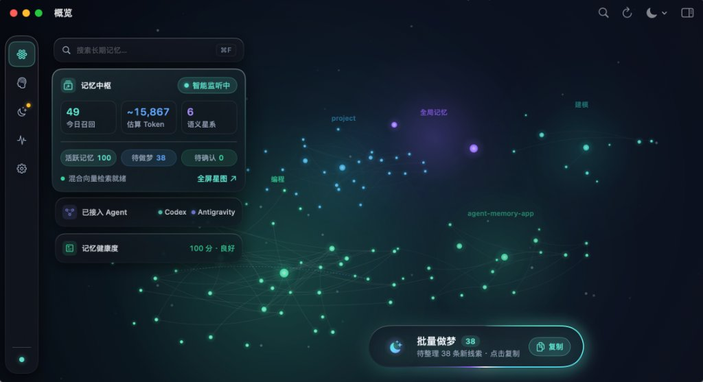
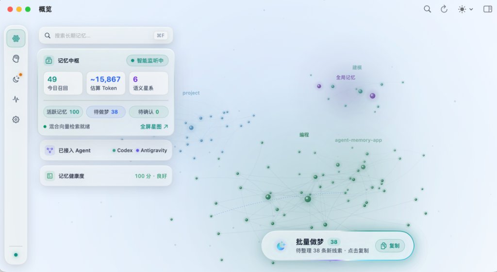
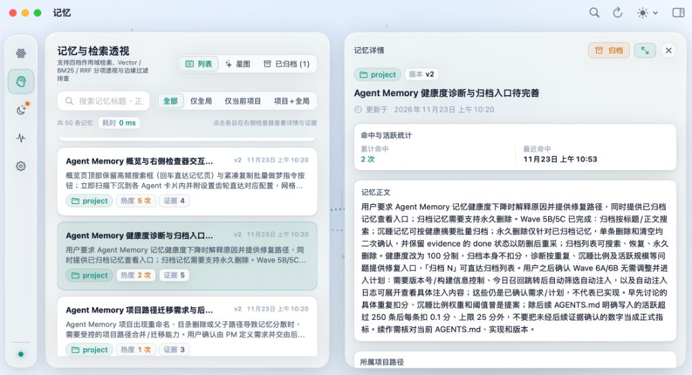
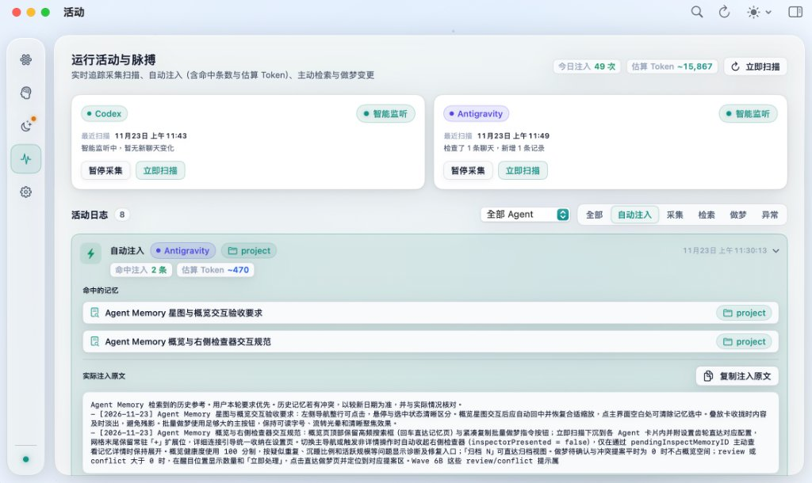
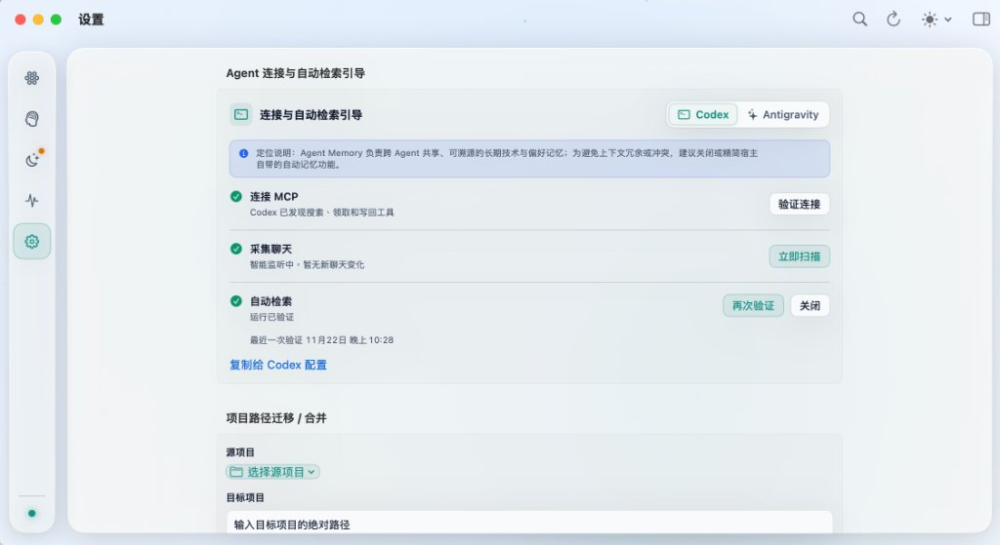
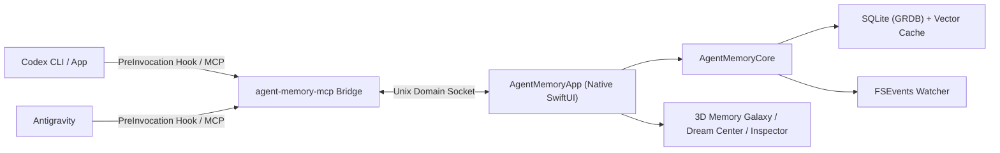

# Agent Memory

> **Local-first cross-agent memory hub for macOS** — 让 Codex、Antigravity 等多个 AI 编程 Agent 共享同一颗本地长期记忆大脑。


<p align="center">
  <picture>
    <source media="(prefers-color-scheme: dark)" srcset="docs/screenshots/overview-dark.jpg">
    <source media="(prefers-color-scheme: light)" srcset="docs/screenshots/overview-light.jpg">
    
  </picture>
</p>

---

## 界面预览

| 深色模式 · 概览与 3D 记忆星系 | 浅色模式 · 液态玻璃与宝石星核 |
| :---: | :---: |
|  |  |

| 记忆检索透视与右侧检查器 | 运行活动与自动注入原文展开 |
| :---: | :---: |
|  |  |

<details>
<summary>点击查看：设置页（多 Agent 连接向导 & 项目路径迁移 / 合并）</summary>



</details>

---

## 为什么做 Agent Memory？

当你同时使用 **Codex**、**Antigravity** 等多个 AI 编程助手时，经常会遇到三个痛点：

1. **跨 Agent 失忆**：在 Codex 里踩过的坑、定好的代码风格和架构决策，换到 Antigravity 里又要重讲一遍。
2. **记忆膨胀与冲突**：无节制堆叠历史记录，最终导致旧决策覆盖新决策、重复记忆满天飞。
3. **无效召回浪费 Token**：传统 RAG 只要有字面重叠就盲目塞进上下文，既污染提示词又白白消耗额度。

**Agent Memory** 是一款纯原生 macOS 桌面应用（零 Electron、零 WebView），把分散在各 Agent 的对话沉淀为**可审查、可追溯、可版本回滚、可视化**的本地长期记忆，并通过 MCP 与 Hook 精准、克制地按需注入。

---

## 核心特性

- **纯本地、隐私优先**：所有记忆、证据片段与本地向量索引均存储在你自己的 Mac（SQLite + GRDB）上，不经过第三方云端。
- **宁缺毋滥的混合检索与自动召回**：
  - 结合本地向量相似度与 BM25 关键词混合排序（RRF），配合停用词过滤、技术词信号识别、严格相关度门槛与 12 轮会话去重，避免把不相关记忆塞进上下文。
  - 注入结果附带日期锚点，明确提示“用户当前要求优先、以较新日期为准”，防止与宿主自带记忆或最新需求冲突。
- **3D 弹性语义星系与液态玻璃空间界面**：
  - 纯原生 SwiftUI `Canvas` 驱动的 3D 缓缓旋转记忆星系：按项目统一星系与配色、32° 侧上方俯视视角与柔和星云底晕，支持 360° 拖拽旋转、抓取单颗星点弹性拉扯、点击直达详情检查器。
  - 当 Codex 或 Antigravity 实时检索命中记忆时，星图对应节点与星云会实时亮起脉冲光环。
  - 完整支持 **跟随系统 / 深色 / 浅色** 三态外观与 **卡片玻璃不透明度（25%–100%）** 自定义。
- **做梦中心（Dream Center）与可追溯审计**：
  - 一键复制「批量做梦」指令交由 Agent 提炼长期记忆，所有拟议变更进入待审队列；概览页实时提醒待确认与冲突提案。
  - 支持「旧内容 vs 拟议变更」并排对比、展开原始对话证据摘录、逐条确认/拒绝，以及按批次一键撤销回滚。
- **100 分制记忆健康度体检与归档管理**：
  - 按疑似重复对、30 天沉睡比例与活跃规模计算 100 分制健康度（归档不扣分），并给出手动修复与 Agent 辅助修复双路径。
  - 完整支持「已归档」记忆列表检索、随时恢复与两段式二次确认永久删除（删后保留证据状态防止重复采集）。
- **活动可观测性与项目路径迁移**：
  - 活动页实时展示 Codex / Antigravity 采集与命中脉搏，点击自动注入日志可展开查看命中的记忆列表与**完整注入原文**。
  - 内置「项目路径迁移 / 合并」（支持设置页一键原子迁移或通过 `agent-memory-mcp --migrate-project` 交由 Agent 执行），轻松应对目录重命名或合并。
- **低功耗多 Agent 接入**：
  - 基于 macOS FSEvents 事件驱动监听 + 防抖策略，长驻菜单栏几乎零功耗。
  - 内置 **Codex** 与 **Antigravity** 一键配置向导与状态自检，支持跨项目自动注入开关。

---

## 架构概览



- **`AgentMemoryCore`**：SQLite 持久化、混合检索（Vector + BM25 + RRF）、去重与召回门槛、语义构图（`MemoryGraph`）、健康度体检与 FSEvents 监听。
- **`AgentMemoryMCP`**：轻量 MCP 协议与 Hook 命令行桥接器（`agent-memory-mcp`），通过本地 Unix Domain Socket 与主应用通信。
- **`AgentMemoryApp`**：纯原生 macOS 14+ SwiftUI 应用与菜单栏常驻端。

---

## 快速开始

### 环境要求

- **macOS 14.0 (Sonoma)** 或更高版本
- **Swift 6.0+**（Xcode 16+ 或 Apple Command Line Tools）

### 1. 克隆并构建 Release `.app`

```bash
git clone https://github.com/w2500769705/Agent-Memory.git
cd Agent-Memory
scripts/build-app.sh
```

构建完成后，会在 `dist/` 目录生成签名好的原生应用包：

```bash
open "dist/Agent Memory.app"
```

### 2. 开发调试与冒烟测试

```bash
# 仅编译
swift build

# 运行核心冒烟测试（30 项覆盖存储、检索、做梦、迁移、归档、构图与脉搏）
swift run AgentMemorySmoke
```

### 3. 接入 Codex 与 Antigravity

打开 **Agent Memory.app** 后，点击设置页中的 Agent 连接引导即可自动写入配置：

- **Codex**：一键配置会话监听、MCP 与自动召回。
- **Antigravity**：一键写入 `~/.gemini/config/mcp_config.json` 与 `~/.gemini/config/hooks.json`。
  > **提示**：首次写入 Antigravity MCP 配置后，请务必彻底退出 Antigravity（`⌘Q`）再重新打开，以重新加载本地 MCP 服务。

---

## 目录结构

```text
.
├── Package.swift
├── Sources/
│   ├── AgentMemoryCore/        # 核心存储、混合检索、健康体检、3D 星图构图、监听引擎
│   ├── AgentMemoryMCP/         # MCP & Hook 桥接可执行程序 (agent-memory-mcp)
│   └── AgentMemoryApp/         # 纯原生 SwiftUI 应用（DesignSystem / State / Views）
├── Tests/
│   └── AgentMemorySmoke/       # 自动化冒烟测试套件
├── Resources/                  # 应用图标与资源
├── docs/screenshots/           # README 界面预览截图
├── scripts/
│   └── build-app.sh            # 一键构建与本地签名 Release .app 脚本
├── VERSION                     # SemVer 版本号
└── DEVELOPMENT.md              # 详细开发与架构说明
```

---

## 路线图

- [x] Codex & Antigravity 双向采集、MCP 检索与 Hook 自动召回
- [x] 宁缺毋滥混合检索门槛、会话去重与防冲突日期锚点
- [x] 做梦中心并排 Diff、原始证据溯源与整批撤销
- [x] 记忆健康度体检（沉睡记忆 / 疑似重复对比）
- [x] 3D 弹性语义星系、实时命中脉搏与液态玻璃空间界面
- [ ] 支持更多 AI Coding Agent（Claude Code、Cursor 等）一键接入

---

## License

本项目采用 [MIT License](LICENSE) 开源。
